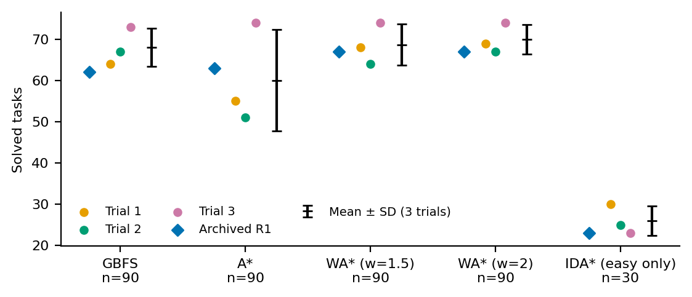
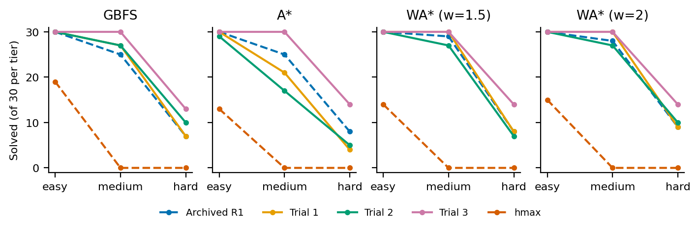

# Coverage, Optimality and Reliability of
LLM-Generated Planning Heuristics

@authors Amina · Faraz · Ranem

@course AICC5102 — Research Reproduction and Extension

@pending authors
Confirm publication names, author order, institutional affiliation, student IDs and course section from the final submission declarations.

## Abstract

Domain-specific Python heuristics generated by large language models (LLMs) offer reusable guidance for classical planning, but their success in finding plans does not establish plan optimality. We reproduce an archived DeepSeek-R1 heuristic baseline and evaluate frozen heuristics with greedy best-first search (GBFS), A*, Weighted A* and iterative-deepening A* (IDA*) on 90 stratified tasks from Blocksworld, Miconic and Transport under a 60-second, 4096-MiB budget. The archived heuristics solve 62/90 tasks with GBFS versus 37/90 for hFF, reproducing the original ranking. Weighted A* at weight 1.5 solves 67/90 tasks, compared with 63/90 for A*, yet A* returns suboptimal plans on 5 of the 17 tasks with a proven optimum. On 305 sampled states with proven true cost, the archived set overestimates on 50–92% of states per domain. Three newly and independently generated heuristic sets (Gemini 3.1 Pro) match or exceed the archived coverage on average, except with A* (60 ± 12.3 versus 63), where they also vary most between trials;; within Miconic, their overestimation ranges from 0% to 99% of states, and only two of the nine new heuristics never overestimate on the sample. These findings support joint evaluation of coverage, plan cost and heuristic accuracy when generated heuristics are transferred to cost-aware search.

## 1. Introduction

Classical planning seeks a sequence of deterministic actions that transforms an initial state into a goal state. Heuristic search makes this task practical by estimating the remaining cost and prioritizing promising states. Domain-independent heuristics can be reused widely, while domain-specific heuristics can exploit structure that generic relaxations miss [5, 6]. LLM-generated executable heuristics provide a route to domain-specific guidance without invoking an LLM at every search step [1].

Coverage and plan quality answer different questions. A heuristic may guide search rapidly to a valid plan while assigning scores that are poorly calibrated to action costs. An admissible heuristic never exceeds the true remaining cost. The optimality properties associated with A* therefore depend on the heuristic and implementation assumptions, rather than the algorithm name alone [3]. Changing the search algorithm is an informative test of whether useful greedy guidance also supports cost-sensitive planning.

We ask: how frequently do LLM-generated heuristics overestimate true remaining planning cost, and how does their use with A*, Weighted A* and IDA*, instead of GBFS, affect efficiency and plan optimality? We contribute a reduced-budget reproduction, a matched search comparison with validated plans and proven-cost references, a sampled-state overestimation study, and three independent generation trials that measure how much these conclusions depend on one generated heuristic set. Our aim is an empirical assessment of the coverage–quality trade-off, with conclusions restricted to the available evidence.

## 2. Related Work

Corrêa et al. [1] generate Python heuristics, select them on training tasks and evaluate them with GBFS. Their released code and data permit reuse of the exact selected functions [2]. Classical cost-aware alternatives include A* [3], weighted heuristic search [4] and IDA* [7]. In planning, hmax is an admissible relaxation-based lower bound, whereas the relaxed-plan heuristic hFF generally sacrifices admissibility [5, 6]. We use Pyperplan as a research prototype [8], without equating its implementation speed with optimized planning systems. LeanPlan [9], a 2026 preprint, instead combines generated heuristics with machine-checked admissibility proofs. Our empirical diagnosis of generated heuristic behavior complements that formal approach; it does not supply an admissibility proof.

## 3. Methodology

### 3.1 Original pipeline and frozen heuristic selection

We retain the original separation between heuristic generation and planning [1, 2]. The generation prompt supplies domain and training-task context and requests a domain-specific Python function. Candidate functions are evaluated on training tasks, and a selected function is then reused on unseen tasks. Test-time planning executes Python code without additional LLM calls. Our reproduction uses the three selected DeepSeek-R1 files released with the original experiments, one per domain, rather than regenerating approximations.

The retained provenance records 25 candidates per domain, 99 training tasks per domain, temperature 1.0 and top-p 0.5. Candidate evaluation used a 300-second, 8192-MiB training budget. The archived selector ranks coverage, summed expansion score and then summed agile score; a strict comparison retains the first exact tie. This implementation detail refines the simplified selection description in the paper. In Miconic, nine candidates share the selected training scores. We freeze the published files and verify their SHA-256 identities (Appendix F).

### 3.2 Search extensions and guarantees

GBFS prioritizes h(s) and retains the inherited early goal test. We add instrumented cost-aware search with path cost g(s). A* and Weighted A* (weights 1.5 and 2) use the following priorities:

@equation f_A*(s) = g(s) + h(s);    f_WA*(s) = g(s) + w h(s),    w ∈ {1.5, 2}.

Both algorithms test goals when removed from the priority queue, track the best known g-value, discard stale entries and reopen a state when a cheaper path is found. Ties use lower h and then insertion order. A weight of one is a correctness-equivalence check against A*, rather than an additional experimental arm. The cost-aware implementations order successors deterministically by operator name.

IDA* performs depth-first traversals within an f = g + h threshold, starting at h(s₀) and increasing to the smallest exceeded value. It uses current-path cycle checks, deterministic successor ordering and no transposition table. Goal tests occur on in-bound successors; counters accumulate repeated work across iterations. This implementation differs from the inherited iterative-deepening search, which is not IDA*.

Under the present finite, unit-cost model, admissibility, zero goal estimates and the stated duplicate/termination rules support optimality for completed A* and IDA* searches. Weighted A* with admissible h and w ≥ 1 has a w-relative solution bound [3, 4, 7]. Resource caps may prevent completion. hmax supplies an admissible lower bound; the generated heuristics have no such certificate. We therefore apply no optimality or weighted-cost guarantee to their plans.

### 3.3 Exact cost, heuristic error and independent generation

We accept a task optimum L* only after exact A* with hmax or uniform-cost search completes and its plan validates. The two solvers are cross-checked where both complete. Unknown outcomes remain missing; a best observed plan or an hmax estimate is not an exact reference. For a valid plan of cost L and proven L* > 0, we report:

@equation gap(%) = 100 × (L − L*) / L*.

For states with finite proven remaining cost h*(s), signed error is h(s) − h*(s), absolute error is its magnitude, and positive error is max(0, h(s) − h*(s)). An overestimate requires h(s) > h*(s) + 10⁻⁹. States are drawn by a frozen, heuristic-independent rule from the 17 tasks with proven L*: the initial state plus 20 distinct end states of seeded random walks whose length is uniform in 1..L*. h*(s) is computed by exact A* with hmax under the same 60 s / 4096 MiB budget; a timeout leaves h*(s) unknown, never infinite.

Three new heuristic sets follow a protocol frozen before any generation (m3-select-v1). Each trial independently asks Gemini 3.1 Pro (gemini-3.1-pro-preview), with the original NeurIPS 2025 prompt, for 10 candidates per domain; Gemini 3+ ignores the requested temperature 1.0 and top-p 0.5 and offers no seed, so calls are independent samples. Candidates are ranked by the authors' selector (coverage, then expansion score, then agile score) using GBFS on 20 evenly spread training tasks per domain at 60 s / 4096 MiB. The winner of each trial and domain is frozen with its SHA-256 before any test run. A trial is a complete generation-and-selection cycle; re-running one file three times would not be a trial.

## 4. Experimental Setup

The frozen aicc5102-90-v1 manifest selects ten easy, ten medium and ten hard tasks in each of Blocksworld, Miconic and Transport from the authors' IPC 2023 Learning Track distribution. Selection uses seed 5102 and preserves the inherited difficulty labels. Each domain also has 99 separate training tasks. Test tasks are excluded from generation, repair and selection. We compare the archived domain-specific DeepSeek-R1 set, denoted R1, with hmax; hFF is included in the GBFS reproduction only. The three new sets are denoted Trial 1–3.

GBFS, A* and both Weighted A* weights each test all 90 tasks per heuristic. IDA* tests the 30 easy tasks only. For R1 and hmax this gives 600 cost-aware and 180 GBFS runs; 90 GBFS runs with hFF complete the 270-run reproduction, for 870 unique runs. The nine trial heuristics are run with the same five algorithm settings, giving 1,170 further runs. Earlier runs with three workers and a historical reproduction on another machine are documented separately (Appendix F) and excluded from all comparisons.

All reported runs use Windows 11, CPython 3.12.12 and frozen dependencies on one machine (machine-f922a64c5235; 24 logical CPUs; approximately 128 GiB RAM), with eight workers executing concurrently. Each task has a 60-second monotonic wall-time limit and a 4096-MiB Windows Job Object process-tree memory cap. Base seed 5102 determines task-scoped Python hash seeds, shared across all compared configurations to control set-order and tie-breaking effects. This control does not measure generation variability or eliminate timing noise.

Coverage counts only returned plans recorded as valid. We report failures separately, use common-solved tasks for paired cost and effort comparisons, and retain missing counters. Total wall time includes startup, grounding and search. There is one run per frozen configuration; variation across generated heuristics is measured by the three independent trials, reported as individual values with mean and sample standard deviation (ddof = 1). We report no significance tests.

Proven optima exist for 17/90 tasks, all easy: two Blocksworld, ten Miconic and five Transport. Thirteen extended reference attempts add no proof. Quality estimates therefore describe a feasibility-selected easy subset. Every successful plan in the reported runs was replayed independently against the grounded task, and a single command re-derives every reported table from the committed run records (Appendix A).

## 5. Results and Discussion

### 5.1 Reproduction

The reproduction confirms the original directional coverage finding: archived R1 outperforms hFF in all three domains (Table 1). Across our 90 tasks, GBFS solves 62 with R1, 37 with hFF and 19 with hmax. R1/hFF solved-count ratios are 2.86, 1.35 and 1.50 in Blocksworld, Miconic and Transport, respectively, against 2.75, 1.22 and 2.03 in the published evaluation. The agreement concerns ranking under the reduced contract, rather than exact replication of published coverage.

{{table|reproduction}}

The published evaluation used 90 test tasks per domain, 1800 seconds, 8192 MiB and PyPy, whereas we use 30 tasks per domain, 60 seconds, 4096 MiB and CPython [1]. Test selection, resources, interpreter and machine therefore differ. These differences constrain absolute comparisons and do not isolate a single cause of discrepancies. Timeouts remain budget failures, not evidence that a task has no solution.

### 5.2 Search Algorithm Comparison

With the same archived R1 functions, coverage is 62/90 for GBFS, 63/90 for A*, and 67/90 for Weighted A* at both weights. Corresponding hmax coverage is 19, 13, 14 and 15 out of 90. Figure 1 shows where coverage changes arise: R1 A* solves 30/30 easy, 25/30 medium and 8/30 hard tasks; weight 1.5 raises medium coverage to 29/30. All eight hard R1 A* solutions are Miconic tasks, and with R1 or hmax no search algorithm solves a hard Blocksworld or Transport task. All hmax solutions are easy. On the matched easy scope, R1 IDA* solves 23/30 versus A*'s 30/30; hmax IDA* solves 7/30. Appendix B separates domains.

Coverage does not imply optimality. On the same 17 proven-reference tasks, mean R1 gaps are 3.31% for GBFS, 2.79% for A* and both weights, and 21.83% for IDA* (Figure 2). Optimal counts are 11, 12, 12, 12 and 2 out of 17, respectively. A* thus remains suboptimal on five tasks despite improving the mean gap by 0.52 percentage points relative to GBFS. IDA*'s median gap is 17.65% and its maximum is 100%.

The weights match A*'s exact gaps on these 17 tasks. On the 63 tasks solved by both a weighted arm and A*, each weighted arm is costlier on six and equal on 57; 55 plans are identical. The extra-cost tasks have unknown optima. The four additional solutions at weight 1.5 therefore constitute a budget-specific coverage gain, with no universal claim of equal plan quality.

Effort comparisons must use matched solved tasks. R1 GBFS/A* has a median expansion ratio of 1.00 on 61 pairs; both weighted/A* ratios are also 1.00 on 63 pairs each. Across the 61 GBFS/A* pairs, A* returns cheaper plans on 18, equal-cost plans on 36 and costlier plans on seven (Appendix D). The archived heuristic's score scale is a plausible contributor to this near-greedy behavior under g + h: if heuristic differences dominate g, path cost has limited influence on ordering. No rescaling intervention isolates this explanation.

IDA* exposes a different trade-off. On 23 common R1 easy solutions it is costlier than A* on 20 and equal on three; its median expansion ratio is 1.19, with a maximum of 2204. With hmax, seven matched tasks have identical optimal costs, but IDA* requires a median 45.1 times as many expansions over a median of eight iterations. Its recorded peak memory never exceeds 22.1 MiB, versus up to 4059 MiB for A*. Of the 780 matched runs, 350 succeed and 430 time out; there is no invalid plan, error, memory-limit or exhaustive-unsolved outcome. A*+hmax is optimal on all 13 reference-known solutions and IDA*+hmax on all seven; weighted hmax runs satisfy their bounds (Appendix E).

### 5.3 Heuristic Reliability and Robustness

Initial-state accuracy. For 17 distinct easy initial states with proven optima, archived R1 overestimates on 15/17, whereas hmax overestimates on 0/17 (median R1 h(s₀)/L* 1.18, maximum 2.10; Appendix D). This certifies that the archived set is inadmissible, but is not a frequency over reachable states.

Sampled-state overestimation. The frozen sample holds 345 states (Blocksworld 42, Miconic 198, Transport 105; one Miconic task yields only nine distinct states). Exact h*(s) is proven for 305 states; 40 (Miconic 13, Transport 27) remain unknown after a timeout and are excluded, and no state is a proven dead end. Figure 3 shows that every heuristic set overestimates in at least one domain; the sample cannot prove admissibility for those that do not. Archived R1 overestimates on 62%, 92% and 50% of eligible Blocksworld, Miconic and Transport states, with mean signed errors of +4.4, +2.9 and +0.9 actions. The new sets differ sharply within a domain: in Miconic, Trials 1 and 2 never overestimate (mean signed error −0.47 and −0.29), whereas Trial 3 overestimates on 99% of states (+14.2). In Transport, Trials 1 and 3 overestimate on every eligible state, and Trial 3 adds a penalty of 100,000 per undelivered package, so its errors reach 400,005 actions; its rate, not its mean error, is the meaningful measure.

Selection and overestimation. Evaluating all 90 generated candidates on the same states shows that overestimation is a property of the selected program rather than of the domain alone: 40 candidates never overestimate (Blocksworld 20/30, Miconic 20/30, Transport 0/30), but only two of the nine selected winners are among them, both in Miconic. In Blocksworld, none of the 20 non-overestimating candidates reached the best training coverage group, so the coverage-first selector never preferred them.

Independent generation. Across the three trials, mean coverage (± sample SD) is 68 ± 4.6 for GBFS, 60 ± 12.3 for A*, 68.7 ± 5.0 and 70 ± 3.6 for Weighted A* at 1.5 and 2, and 26 ± 3.6 of 30 for IDA*; the archived set solves 62, 63, 67, 67 and 23 (Table 8, Figure 7). Generated heuristics therefore match or exceed the archived coverage on average, except with A*, where variation is largest: Trials 1 and 2 solve only 12/30 Miconic tasks with A*, Trial 3 solves 30/30. Difficulty scaling follows the same pattern (Figure 8): with GBFS, A* and Weighted A*, every set solves 29–30 of 30 easy tasks, but hard-tier coverage ranges from 4/30 (Trial 1, A*) to 13–14/30 (Trial 3), against 7–9 for the archived set.

Heuristic error and plan quality. On the 17 proven-reference tasks, median gaps are 0% in most configurations; the exceptions are Trial 1 with GBFS (5.0%) and Weighted A* at weight 2 (3.85%), and IDA* with the archived set (17.6%) and Trial 3 (80%). Mean A* gaps range from 1.38% (Trial 3) to 3.06% (Trial 1). Across 68 task outcomes per method, the Spearman correlation between a task's mean positive error and its plan gap is weak to moderate for GBFS, A* and Weighted A* (0.08–0.35), and strong for IDA* (0.93, n = 66). The IDA* association is driven by Trial 3's penalty heuristic, which yields valid but extremely long plans; plausibly, its huge initial bound lets the first IDA* iteration accept a very long path (Figure 6). These are descriptive associations between dependent task-level outcomes, not causal effects.

## 6. Limitations

Our benchmark covers three of the original eight domains and a stratified test subset. The short budget and Python prototype limit comparisons with optimized planners or larger allocations. One machine, eight concurrent workers and a single run per configuration provide no estimate of timing uncertainty; runs near the 60 s limit can change status between machines. Solved-only comparisons exclude failures and require coverage context. Matching the original 1800 s / 8192 MiB budget, PyPy, all 90 test tasks per domain and all eight domains was not feasible in the project time frame; we therefore claim the ranking, not the absolute coverage.

Exact quality and state-level error are available only for the 17 easy tasks, ten from Miconic, and 40 of 345 sampled states have no proven h*. Reference feasibility therefore selects the evaluation population, and the samples can reveal overestimation but cannot prove admissibility. IDA* has no medium/hard evidence. The new trials use a different model (Gemini 3.1 Pro rather than DeepSeek-R1), 10 instead of 25 candidates and 20 training tasks at 60 s instead of 99 at 300 s, so differences from the archived set mix model and protocol effects. Gemini ignores sampling settings and offers no seed, and three trials give only a rough estimate of generation variability.

## 7. Conclusion

The reduced-budget reproduction agrees with the original finding that archived LLM guidance improves coverage over hFF. Keeping that guidance fixed while changing search reveals a sharper distinction between finding plans and finding optimal plans: Weighted A* improves coverage, A* remains suboptimal on some reference-known tasks, and IDA* exhibits substantial quality and repeated-work costs. On sampled states with proven costs, every heuristic set overestimates in some domain, and the overestimation frequency of independently generated sets ranges from 0% to 99% within one domain, depending on which candidate the coverage-first selector picks. Average coverage is robust across generation trials except under A*, where individual trials differ by up to 23 solved tasks. Practical evaluation should therefore report coverage, matched effort, proven-reference quality and heuristic accuracy together, across more than one generated heuristic set.

@page

## References

[1] Augusto B. Corrêa, André G. Pereira, and Jendrik Seipp. 2025. Classical Planning with LLM-Generated Heuristics: Challenging the State of the Art with Python Code. Advances in Neural Information Processing Systems 38. https://proceedings.neurips.cc/paper_files/paper/2025/hash/3bf4b55960aaa23553cd2a6bdc6e1b57-Abstract-Conference.html

[2] Augusto B. Corrêa, André Grahl Pereira, and Jendrik Seipp. 2025. LLM-Generated Heuristics. Software and experimental data, version 0.1.0, Zenodo. https://doi.org/10.5281/zenodo.17400964. Imported code snapshot: https://github.com/abcorrea/llm-generated-heuristics, commit 4c3deabc058e3ab181250a742181412507920d18.

[3] Peter E. Hart, Nils J. Nilsson, and Bertram Raphael. 1968. A Formal Basis for the Heuristic Determination of Minimum Cost Paths. IEEE Transactions on Systems Science and Cybernetics 4(2):100–107. https://doi.org/10.1109/TSSC.1968.300136.

[4] Ira Pohl. 1970. Heuristic Search Viewed as Path Finding in a Graph. Artificial Intelligence 1(3–4):193–204. https://doi.org/10.1016/0004-3702(70)90007-X.

[5] Blai Bonet and Héctor Geffner. 2001. Planning as Heuristic Search. Artificial Intelligence 129(1–2):5–33. https://doi.org/10.1016/S0004-3702(01)00108-4.

[6] Jörg Hoffmann and Bernhard Nebel. 2001. The FF Planning System: Fast Plan Generation Through Heuristic Search. Journal of Artificial Intelligence Research 14:253–302. https://doi.org/10.1613/jair.855.

[7] Richard E. Korf. 1985. Iterative-Deepening-A*: An Optimal Admissible Tree Search. Proceedings of the Ninth International Joint Conference on Artificial Intelligence, pp. 1034–1035. https://ijcai.org/proceedings/1985/208.

[8] Yusra Alkhazraji, Matthias Frorath, Markus Grützner, Malte Helmert, Thomas Liebetraut, Robert Mattmüller, Manuela Ortlieb, Jendrik Seipp, Tobias Springenberg, Philip Stahl, and Jan Wülfing. 2020. Pyperplan. Zenodo. https://doi.org/10.5281/zenodo.3700819. Software citation supplied by https://github.com/aibasel/pyperplan; the evaluated fork is pinned in reference [2].

[9] André G. Pereira, Augusto B. Corrêa, Felipe Meneguzzi, and Jendrik Seipp. 2026. LeanPlan: Optimal Planning with LLM-Generated Heuristics and Admissibility Proofs. arXiv preprint arXiv:2610.08246v1, submitted 6 October 2026. https://arxiv.org/abs/2610.08246v1.

@page

## Appendix A. Evidence, configuration and validation

Table 2 records the experimental contract. Raw records, plans, logs and batch files are under results/raw/run_records; the reported tables are under results/derived/reproduction, results/derived/search_comparison, results/derived/search_analysis_all_tasks, results/derived/search_analysis_easy_tasks and results/derived/heuristic_reliability, with figures under the matching results/figures folders.

{{table|setup}}

The command tools/verify_all.py re-checks every reported number without running a planner: benchmark and heuristic hashes; that every planned run (270 reproduction, 600 search, 1,170 trial runs) exists exactly once with the configured limits and task seed; independent replay of every saved successful plan (118, 269 and 878 plans); that each trial run used the frozen file of its trial and started after it was frozen; rebuilt run tables; and recomputation of all result tables, which must equal the committed ones. All 16 checks pass.

We preserve missing worker statistics as missing: 78 of the 600 cost-aware search runs time out without reporting expansion counts. GBFS search-time fields and cost-aware worker search-time fields differ in clock and scope, so paired runtime uses total wall time. Display values round existing CSVs for readability; CSV precision remains authoritative.

@page

## Appendix B. Coverage by domain and difficulty

{{table|coverage}}

Table 3 exposes the hard-tier domain concentration and the easy-only scope of IDA*. A dash marks a scope that was not evaluated; zero is an observed absence of valid solutions under the resource contract. Every domain/tier entry has ten attempted tasks when evaluated. Aggregating the three domain counts gives Figure 1, rather than an additional independent experiment.

@page

## Appendix C. Reference availability and complete search summary

{{table|summary}}

Table 4 supplements the main figures. R1 gaps use the same 17 tasks. hmax GBFS solves 19 tasks, but only 16 have proven optima; the other three receive no exact gap.

{{table|references}}

The reference register also contains 43 unknown timeouts and 30 not-requested hard tasks. Thirteen extended attempts add no proof. Both exact solvers agree where they complete; UCS alone proves three additional costs. References never use the best observed heuristic-arm plan.

@page

## Appendix D. Paired effort and initial-state accuracy

{{table|pairs}}

A median of taskwise ratios is not the ratio of aggregate totals. On the four-method R1 common-solved intersection (61 tasks), total expansions are 24,467 for GBFS, 39,030 for A*, 24,420 for weight 1.5 and 24,354 for weight 2. On the five-method easy intersection (23 tasks), IDA* accumulates 619,891 expansions versus 3,872 for A*. These differing scopes explain why a typical ratio near one can coexist with substantial tail or total differences.

@page

## Appendix E. Failures and guarantee audit

{{table|failures}}

All observed failures in the matched matrix are timeouts. Missing worker output does not locate a termination in grounding or search; grounding one hard Transport task alone exceeds the budget, and seven hard Transport tasks never reach search in any configuration.

For hmax, the proof-eligible optimality checks comprise 13 A* and seven IDA* outcomes; the weighted-bound checks comprise 14 and 15 outcomes at weights 1.5 and 2. All meet their respective guarantee. Weight 2 returns two suboptimal plans within its bound. GBFS and all generated-heuristic arms have no applicable general guarantee, so the absence of an audited violation must not be read as evidence of optimality. Unknown-reference runs are excluded from these empirical checks.

## Appendix F. Reproduction and frozen-heuristic provenance

The reported reproduction uses the shared GBFS runner and summarizer, with task-scoped hash seeds on the same machine and eight workers as the search matrix. Two earlier result sets are kept for traceability but excluded from all comparisons: the same experiments run with three workers (GBFS 64/38/19 for R1/hFF/hmax; A* 65, Weighted A* 70 and 69), whose differences likely come from runs near the time limit runs near the time limit under different parallel load, and a first reproduction on another machine with run-scoped seeds (53/25/14).

The archived set was generated with DeepSeek-R1 and selected using training tasks. The selected files are blocksworld9_10.py, miconic11_10.py and transport7_10.py. Their complete SHA-256 values are:

@hash blocksworld9_10.py|106d55bfa8968f65cc88e26019a9c2163a2a74e408997c83e6a91d69293c5079

@hash miconic11_10.py|10c099e50edec42b1139285639b22b900c56a5ba581d135d8361e12d07b63cf9

@hash transport7_10.py|36b883d5f14d08dcb32af30e00d05fa4d44b371a9481fe82005a71f8f14bb290

The provenance JSON retains archive paths, log/property hashes, selector identity and training-score ties. Full prompts and responses are retrievable from the archive [2].

@page

## Appendix G. Reliability and independent-trial supplement

{{table|trials}}

Generation and selection protocol. All 90 generated answers (3 trials × 3 domains × 10 candidates) passed the code check: one class whose name ends in Heuristic and no other such name. All were evaluated on the training tasks, and every training plan was validated. The nine winners and their SHA-256 values are listed in artifacts/m3/heuristic_manifest.csv with model, prompt hash, settings and freeze time; the last file was frozen at 02:27 UTC on 22 November 2026, before the first test run at 06:06 UTC. Full prompts, raw answers, generation logs and per-candidate training runs and scores are committed.

State sampling and references. The sampling protocol (m3-r6-states-v1) and its 345-state inventory (SHA-256 b00e03d9…a8b) were frozen before any heuristic was evaluated on them. Exact h*(s) is proven for 305 states and unknown for 40 after a timeout; one sampled state is a goal state (h* = 0), and no state is a proven dead end. One non-selected candidate (Blocksworld, Trial 3) raised errors on seven states, recorded separately; the nine selected heuristics returned a valid estimate on every state.

## Appendix H. Contributions and AI-use declaration

Repository records support the following completed contributions. Amina developed the reproduction workflow and the shared experiment runner, including the integration of A*, Weighted A* and IDA* into it. Faraz developed and evaluated the search extensions, exact-cost references, paired analyses and audits, executed the final eight-worker runs of the reproduction and search matrix, and prepared the paper tables and figures. Ranem designed and executed the heuristic generation and selection protocol and the three trials, the sampled-state overestimation study and the trial analyses, and integrated the final code, tests, verification tool and documentation.

@pending contributions
Confirm the per-person contribution statement above, institutional author details, student IDs and course section. Obtain author agreement before submission.

AI-use statement. OpenAI Codex assisted with the earlier draft of this paper, repository inspection, document-generation code, numerical consistency checks and layout review. Claude Code (Anthropic) assisted with branch integration, file renaming, the verification tool, tests, figure scripts, documentation and this revision of the draft. Gemini 3.1 Pro generated the candidate heuristics as part of the experimental method. No AI tool ran planning experiments outside the recorded pipeline or produced unrecorded results. The authors verify and take responsibility for the final text and claims.

@pending aidisclosure
Each author confirms or completes their own AI-use statement (tools, and use in code, experiments, analysis and writing) against the original assignment brief.
